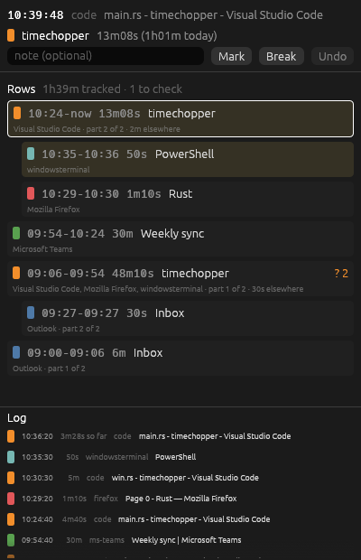
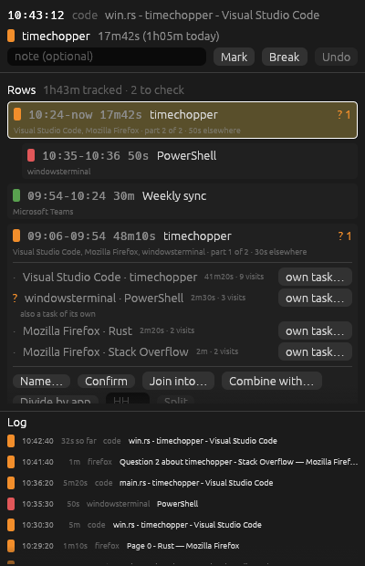

# timechopper

> **Proof of concept.** This is an experiment, not finished software: expect
> rough edges, changing behaviour and log formats, and no support.

timechopper watches which window you are using on Windows and groups the day
into tasks in a small always-on-top panel, so that when you forget to note a
task switch you can see when it happened and correct the grouping as you go.




## Running it

On Windows, with [Rust](https://rustup.rs) installed:

```
cargo install --git https://github.com/ellbur/timechopper
timechopper ui
```

The day's log is kept in `%LOCALAPPDATA%\timechopper\`, and restarting on the
same day carries on from it.
